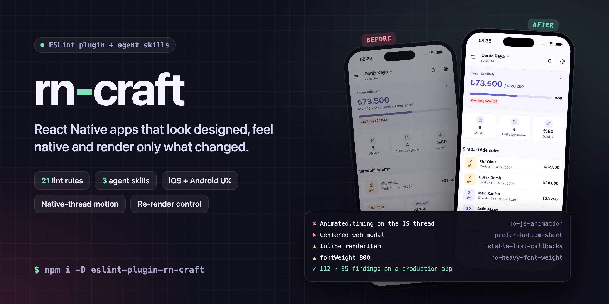
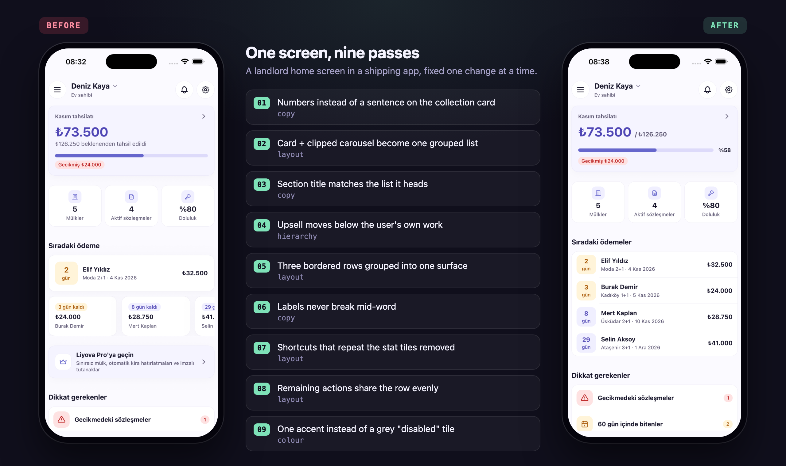

<p align="center">
  
</p>

<p align="center">
  <b>English</b> · <a href="README.tr.md">Türkçe</a>
</p>

<p align="center">
  
  
  
  
</p>

# rn-craft

**Design, UX and performance rules for React Native, built for AI coding agents and the people who review their
work.**

AI agents write React Native the way they write the web. You get centered modals instead of sheets, `Animated.timing`
on the JS thread, `fontWeight: '800'` everywhere and glowing buttons. Lists re-render every row because `renderItem`
is inline. A `useSelector` returns the whole store. Each of these is small. Together they make an app that looks
generated and drops frames.

rn-craft catches these mistakes in two places:

| | What it is | When it acts |
|---|---|---|
| **`eslint-plugin-rn-craft`** | 21 lint rules for visual, UX, motion, accessibility, copy, rendering, state and list mistakes | In the editor, in CI, and every time an agent runs `lint` |
| **Agent skills** | `rn-craft`, `rn-craft-fix`, `rn-craft-perf`, `rn-craft-init`, `rn-craft-arch`: playbooks for building, fixing and profiling screens, setting up projects and wiring features | While the agent writes code, before lint ever runs |

Lint catches what can be read from code. The skills cover the rest: platform patterns, motion timing, where state
lives, how to measure.

## At a glance

- **Native, not web.** Bottom sheets instead of centered modals. Native stack. Own themed controls with platform
  behaviour, thumb zone, safe areas on every device, keyboard.
- **Motion on the UI thread.** No JS-driven animation. Transform and opacity only. 150-300 ms. No bounce and no
  endless loops. Reduce Motion is respected.
- **One visual scale.** 4 pt spacing grid, a radius scale, a type scale and theme colours. Weights stop at 700 and
  shadows stay soft.
- **Renders only what changed.** Stable list callbacks, memoized context values, derived state instead of copied
  state, narrow store selectors, no `setState` on scroll.
- **Accessible and locale-aware.** Named icon buttons, font scaling left on, `toLocaleUpperCase` for Turkish i/İ,
  calm copy.

## Proven on a shipping app

We ran rn-craft on **Liyova Pro**, a property management app in production (React Native 0.88, Reanimated 4, Redux
Toolkit). One screen, every frame from the simulator, one fix per pass:

<p align="center">
  
</p>

The first lint pass across the whole app, before and after the fixes:

| Rule | Before | After |
|---|---:|---:|
| `no-heavy-font-weight` | 8 | **0** |
| `style-scale` | 7 | **0** |
| `no-heavy-shadow` | 3 | **0** |
| `animate-transform-opacity` | 2 | **0** |
| `context-value-stable` | 1 | **0** |
| `stable-list-callbacks` | 5 | 3 |
| `no-index-key` | 3 | 2 |
| `prefer-bottom-sheet` | 2 | 1 |
| **All rules** | **112** | **85** |

The 85 that remain are mostly project decisions, not bugs. They come from `use-shared-components` and
`no-raw-colors` in the theme and brand files, and from short static lists that were left on `ScrollView` on purpose.
Each one either gets a fix or a disable comment saying why. Either way it is a decision someone made, not one that
slipped through.

## Quick start

### 1. Install

```bash
npm install --save-dev eslint-plugin-rn-craft
```

### 2. Turn it on

**ESLint 9** (`eslint.config.js`)

```js
const rnCraft = require('eslint-plugin-rn-craft');

module.exports = [
  // ...your config
  rnCraft.configs['flat/recommended'],
  // React Compiler on? Add this after it: it turns off the two rules the compiler makes redundant.
  // rnCraft.configs['flat/compiler'],
];
```

**ESLint 8** (`.eslintrc.js`)

```js
module.exports = {
  extends: ['@react-native', 'plugin:rn-craft/recommended'],
  // React Compiler on? Add 'plugin:rn-craft/compiler' after it.
};
```

### 3. Give your agent the skills

```bash
npx skills add hasaneks/rn-craft
```

You can also copy `skills/rn-craft*` into your agent's skills folder by hand (for Claude Code: `.claude/skills/`).
Then ask for work in plain words: *"build the settings screen"*, *"this screen looks generated, fix it"*, *"the feed
drops frames"*. The right skill loads on its own.

## Configs

| Config | For | What it does |
|---|---|---|
| `recommended` / `flat/recommended` | Every app | Accessibility, state selectors and JS animation are errors; the rest are warnings |
| `strict` / `flat/strict` | Teams with a finished design system | Everything is an error, every spacing, radius and font size must come from theme tokens, and the legacy `Animated` API is banned |
| `compiler` / `flat/compiler` | Apps with React Compiler | Turns off `stable-list-callbacks` and `context-value-stable`, which the compiler handles |

## Rules

| Rule | Area | Catches |
|---|---|---|
| [`style-scale`](RULES.md#style-scale) | Visual | Spacing off the 4 pt grid, radius and font size off the scale; with `requireTokens`, any raw number |
| [`no-raw-colors`](RULES.md#no-raw-colors) | Visual | `#hex` / `rgba()` in styles and colour props instead of theme tokens |
| [`no-heavy-font-weight`](RULES.md#no-heavy-font-weight) | Visual | `fontWeight` 800-900 |
| [`no-heavy-shadow`](RULES.md#no-heavy-shadow) | Visual | Large shadow radius or opacity, high elevation, large `boxShadow` blur |
| [`no-emoji`](RULES.md#no-emoji) | Visual | Emoji in interface text |
| [`use-shared-components`](RULES.md#use-shared-components) | Visual | Raw `Pressable` / `TextInput` / ... where the app has its own component |
| [`prefer-bottom-sheet`](RULES.md#prefer-bottom-sheet) | UX | A centered `Modal` that is not a native page or form sheet |
| [`no-excessive-motion`](RULES.md#no-excessive-motion) | Motion | Animations over 400 ms, bouncy springs, bounce or elastic easing, showy entrances, endless loops |
| [`no-js-animation`](RULES.md#no-js-animation) | Motion | `Animated` without the native driver, `requestAnimationFrame` state loops, JS animation libraries |
| [`animate-transform-opacity`](RULES.md#animate-transform-opacity) | Motion | Width, height, margin or top animated in `useAnimatedStyle` |
| [`pressable-name`](RULES.md#pressable-name) | Accessibility | Icon-only pressables without an `accessibilityLabel` |
| [`no-disabled-font-scaling`](RULES.md#no-disabled-font-scaling) | Accessibility | `allowFontScaling={false}` |
| [`locale-aware-case`](RULES.md#locale-aware-case) | Copy | `toUpperCase()` / `toLowerCase()` on user-facing text (Turkish i/İ) |
| [`no-exclamation-copy`](RULES.md#no-exclamation-copy) | Copy | Interface copy ending in "!" |
| [`stable-list-callbacks`](RULES.md#stable-list-callbacks) | Rendering | Inline `renderItem`, inline header or footer components, a changing `onViewableItemsChanged` |
| [`context-value-stable`](RULES.md#context-value-stable) | Rendering | `value={{ ... }}` on a context provider |
| [`no-derived-state-effect`](RULES.md#no-derived-state-effect) | Rendering | A `useEffect` that only copies values into state |
| [`no-scroll-setstate`](RULES.md#no-scroll-setstate) | Rendering | `setState` inside `onScroll` or gesture handlers |
| [`store-selector`](RULES.md#store-selector) | State | Whole-store selectors, selectors that return new objects without an equality check |
| [`no-index-key`](RULES.md#no-index-key) | Lists | Array index used as `key` or returned from `keyExtractor` |
| [`no-scrollview-map`](RULES.md#no-scrollview-map) | Lists | A `ScrollView` rendering a growing `.map()` |

**What a finding looks like:**

```text
src/features/feed/FeedScreen.tsx
  42:7  warning  renderItem is a new function on every render of this component, so every
                 visible row re-renders. Hoist it or wrap it in useCallback       rn-craft/stable-list-callbacks
  88:5  error    Animated.timing runs on the JS thread (useNativeDriver is not set).
                 Set useNativeDriver: true, or move it to Reanimated               rn-craft/no-js-animation
```

### Options worth setting

```js
rules: {
  // Your theme's scale, or tokens only.
  'rn-craft/style-scale': ['warn', { requireTokens: ['spacing', 'radius'] }],
  // Point raw primitives at your own components.
  'rn-craft/use-shared-components': ['warn', {
    components: { Pressable: 'Button or IconButton', TextInput: 'Input', Modal: 'BottomSheet' },
  }],
  // An IconButton whose `label` prop becomes the accessibilityLabel.
  'rn-craft/pressable-name': ['error', { components: ['IconButton'], labelProps: ['label'] }],
  // Your typed store hooks.
  'rn-craft/store-selector': ['error', { selectorHooks: ['useAppSelector'] }],
}
```

Some files break a rule on purpose: the theme file defines raw colours, brand artwork, your own `Button` built on
`Pressable`. Turn the rule off for those files with a comment that says why.

## Skills

| Skill | Use it when | What it does |
|---|---|---|
| [`rn-craft`](skills/rn-craft/SKILL.md) | Building or reviewing any screen, component, list, sheet, animation or store code | Rules to follow while writing: platform patterns, motion, scale, accessibility, re-renders, state placement |
| [`rn-craft-fix`](skills/rn-craft-fix/SKILL.md) | A screen looks generated or does not feel native | Audits the screen, picks a direction, fixes it one pass at a time and shows each step before and after |
| [`rn-craft-perf`](skills/rn-craft-perf/SKILL.md) | A screen is slow, janky or re-renders too much | Measures first (React DevTools Profiler, Perf Monitor, Flashlight, Instruments), then fixes re-renders, state, lists, animation and startup |
| [`rn-craft-init`](skills/rn-craft-init/SKILL.md) | Starting a new app, choosing the stack, adding environments, upgrading React Native | Product intake, latest stable React Native with a pinned compatibility table, Community CLI by default, Yarn, dev/staging/prod identities, feature-based structure, `STACK.md` |
| [`rn-craft-arch`](skills/rn-craft-arch/SKILL.md) | Building the API layer, storage, i18n, permissions, Firebase, purchases, ads, camera, OTA, tests or a release | RTK Query, MMKV with Keychain/Keystore keys, i18next, soft permissions, push, Adapty, AdMob, Hot Updater on AWS, force update and kill switches, store compliance, and when a feature counts as done |

A project's `DESIGN.md` overrides the defaults. Put your house rules there: the brand accent, the components to
use, and what your product never does. The skills read it first.

### House stack: `STACK.md`

`rn-craft-init` and `rn-craft-arch` come with a default stack: Community CLI, TypeScript, Yarn, React Navigation,
Redux Toolkit + RTK Query, MMKV, i18next, react-hook-form + Zod, Reanimated, `@gorhom/bottom-sheet`, React Native
Firebase, and Adapty, AdMob, Vision Camera, Skia and Hot Updater when the product needs them. A project's `STACK.md`
overrides any of it and holds the decisions an agent must not guess, such as the bundle id prefix
(`com.limoncreatif` → `com.limoncreatif.<appslug>`). The template is in
[`skills/rn-craft-init/references/stack-template.md`](skills/rn-craft-init/references/stack-template.md).

## FAQ

**Does it work with Expo?** Yes. The rules read plain React Native code, so Expo, bare React Native and Expo Router
all work. `rn-craft-init` creates new apps with the Community CLI unless you ask for Expo, and keeps an existing Expo
app on Expo.

**Does it replace `@react-native/eslint-config` or `eslint-plugin-react-native`?** No, it sits next to them. Those
cover JavaScript and React correctness. rn-craft covers how the app looks, moves and renders.

**I use React Compiler.** Add the `compiler` config after `recommended`. The compiler memoizes inline callbacks and
context values itself, so those two rules turn off.

**Why is `Animated` an error?** On the JS thread an animation stutters whenever JavaScript is busy. With
`useNativeDriver: true` it is allowed. `strict` bans the API entirely in favour of Reanimated.

**Will it flag my design system?** The visual rules only look at style contexts: `StyleSheet.create`, `style` props,
`useAnimatedStyle` and style factories. Set your own scale or require tokens, and switch the rules off per file where
your theme defines the raw values.

## Development

```bash
npm install
npm test        # 148 RuleTester cases on node:test
```

Every rule lives in `lib/rules/`, with its tests in `tests/` and its documentation in [RULES.md](RULES.md). A new
rule needs all three. It must also leave no false positives when run on a real app.

## Licence

[MIT](LICENSE) © Hasan Ekşi
