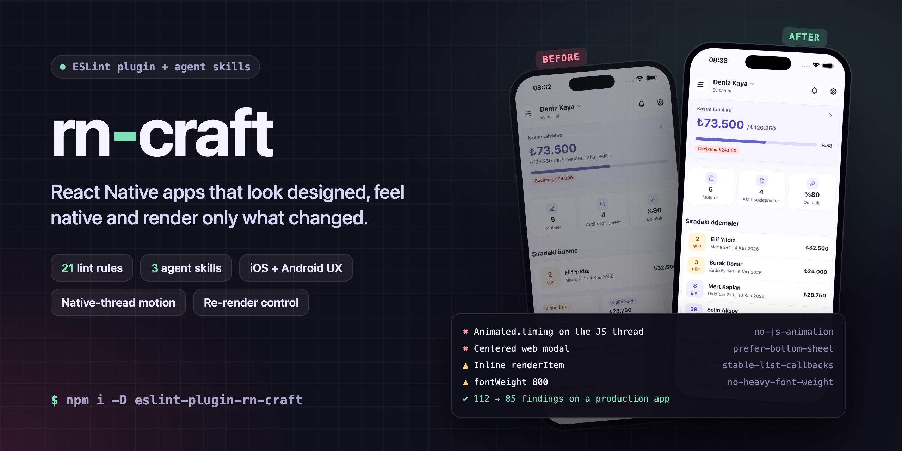
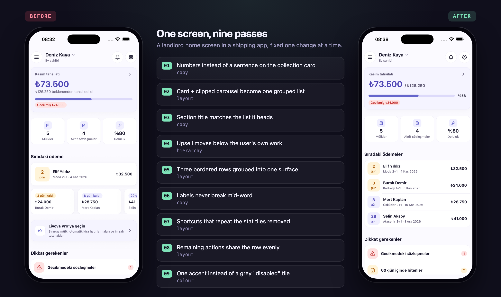

<p align="center">
  
</p>

<p align="center">
  <a href="README.md">English</a> · <b>Türkçe</b>
</p>

<p align="center">
  
  
  
  
</p>

# rn-craft

**React Native için tasarım, UX ve performans kuralları. Yapay zeka kod ajanları ve onların işini inceleyen
insanlar için yazıldı.**

Yapay zeka ajanları React Native'i web yazar gibi yazıyor. Bottom sheet yerine ekranın ortasında açılan modallar,
JS thread'inde çalışan `Animated.timing`, her yerde `fontWeight: '800'` ve parlayan butonlar çıkıyor. `renderItem`
satır içinde yazıldığı için listeler her satırı yeniden render ediyor. Bir `useSelector` tüm store'u döndürüyor.
Bunların her biri küçük bir şey. Bir araya geldiklerinde uygulama "üretilmiş" görünüyor ve kare atlıyor.

rn-craft bu hataları iki yerde yakalar:

| | Ne | Ne zaman devreye girer |
|---|---|---|
| **`eslint-plugin-rn-craft`** | Görsel, UX, animasyon, erişilebilirlik, metin, render, state ve liste hataları için 21 lint kuralı | Editörde, CI'da ve ajan her `lint` çalıştırdığında |
| **Agent skill'leri** | `rn-craft`, `rn-craft-fix`, `rn-craft-perf`, `rn-craft-init`, `rn-craft-arch`: ekran yazma, düzeltme, ölçme, proje kurma ve özellik entegrasyonu rehberleri | Ajan kodu yazarken, lint daha çalışmadan |

Koddan okunabilen hataları lint yakalar. Gerisini skill'ler kapsar: platform kalıpları, animasyon süreleri, state'in
nerede tutulacağı ve nasıl ölçüleceği.

## Bir bakışta

- **Web değil, native.** Ortalanmış modal yerine bottom sheet. Native stack. Platform davranışını koruyan kendi
  temalı bileşenler, başparmak bölgesi, her cihazda safe area, klavye.
- **Animasyon UI thread'inde.** JS ile sürülen animasyon yok. Yalnızca transform ve opacity. 150-300 ms. Zıplama ve
  sonsuz döngü yok. Hareketi Azalt ayarına uyulur.
- **Tek görsel ölçek.** 4 pt boşluk ızgarası, bir radius ölçeği, bir yazı ölçeği ve tema renkleri. Font ağırlığı
  700'de durur, gölgeler yumuşak kalır.
- **Yalnızca değişen render edilir.** Sabit liste callback'leri, memo'lanmış context değerleri, kopyalanan state
  yerine türetilen değerler, dar store selector'ları, scroll sırasında `setState` yok.
- **Erişilebilir ve dile duyarlı.** İsmi olan ikon butonları, açık kalan yazı büyütme, Türkçe i/İ için
  `toLocaleUpperCase`, sakin bir metin dili.

## Gerçek bir uygulamada denendi

rn-craft'ı yayında olan bir mülk yönetimi uygulaması olan **Liyova Pro** üzerinde çalıştırdık (React Native 0.88,
Reanimated 4, Redux Toolkit). Tek ekran, her kare simülatörden, her adımda tek düzeltme:

<p align="center">
  
</p>

Uygulamanın tamamında ilk lint taraması, düzeltmelerden önce ve sonra:

| Kural | Önce | Sonra |
|---|---:|---:|
| `no-heavy-font-weight` | 8 | **0** |
| `style-scale` | 7 | **0** |
| `no-heavy-shadow` | 3 | **0** |
| `animate-transform-opacity` | 2 | **0** |
| `context-value-stable` | 1 | **0** |
| `stable-list-callbacks` | 5 | 3 |
| `no-index-key` | 3 | 2 |
| `prefer-bottom-sheet` | 2 | 1 |
| **Tüm kurallar** | **112** | **85** |

Kalan 85 bulgunun çoğu hata değil, projenin kendi kararı. Bunlar tema ve marka dosyalarındaki
`use-shared-components` ve `no-raw-colors` bulguları ile bilerek `ScrollView`'da bırakılmış kısa, sabit listelerden
geliyor. Her biri ya düzeltilir ya da nedenini söyleyen bir kapatma yorumu alır. Her iki durumda da gözden kaçmış
değil, biri tarafından verilmiş bir karardır.

## Hızlı başlangıç

### 1. Kur

```bash
npm install --save-dev eslint-plugin-rn-craft
```

### 2. Aç

**ESLint 9** (`eslint.config.js`)

```js
const rnCraft = require('eslint-plugin-rn-craft');

module.exports = [
  // ...kendi ayarlarınız
  rnCraft.configs['flat/recommended'],
  // React Compiler açık mı? Bunu ondan sonra ekleyin: derleyicinin gereksiz kıldığı iki kuralı kapatır.
  // rnCraft.configs['flat/compiler'],
];
```

**ESLint 8** (`.eslintrc.js`)

```js
module.exports = {
  extends: ['@react-native', 'plugin:rn-craft/recommended'],
  // React Compiler açık mı? Ardından 'plugin:rn-craft/compiler' ekleyin.
};
```

### 3. Skill'leri ajanınıza verin

```bash
npx skills add hasaneks/rn-craft
```

`skills/rn-craft*` klasörlerini ajanınızın skill klasörüne elle de kopyalayabilirsiniz (Claude Code için:
`.claude/skills/`). Sonra işi düz cümlelerle isteyin: *"ayarlar ekranını yap"*, *"bu ekran üretilmiş gibi duruyor,
düzelt"*, *"akış kare atlıyor"*. Doğru skill kendiliğinden yüklenir.

## Config'ler

| Config | Kimin için | Ne yapar |
|---|---|---|
| `recommended` / `flat/recommended` | Her uygulama | Erişilebilirlik, store selector'ları ve JS animasyonu hata; geri kalanı uyarı |
| `strict` / `flat/strict` | Tasarım sistemi oturmuş ekipler | Her şey hata olur, tüm boşluk, radius ve font boyutları tema token'larından gelmek zorundadır ve eski `Animated` API'si yasaklanır |
| `compiler` / `flat/compiler` | React Compiler kullanan uygulamalar | Derleyicinin zaten çözdüğü `stable-list-callbacks` ve `context-value-stable` kurallarını kapatır |

## Kurallar

| Kural | Alan | Yakaladığı |
|---|---|---|
| [`style-scale`](RULES.md#style-scale) | Görsel | 4 pt ızgaranın dışındaki boşluklar, ölçek dışı radius ve font boyutları; `requireTokens` ile her ham sayı |
| [`no-raw-colors`](RULES.md#no-raw-colors) | Görsel | Tema token'ı yerine stillerde ve renk prop'larında `#hex` / `rgba()` |
| [`no-heavy-font-weight`](RULES.md#no-heavy-font-weight) | Görsel | `fontWeight` 800-900 |
| [`no-heavy-shadow`](RULES.md#no-heavy-shadow) | Görsel | Büyük gölge yarıçapı ya da opaklığı, yüksek elevation, büyük `boxShadow` bulanıklığı |
| [`no-emoji`](RULES.md#no-emoji) | Görsel | Arayüz metninde emoji |
| [`use-shared-components`](RULES.md#use-shared-components) | Görsel | Uygulamanın kendi bileşeni varken ham `Pressable` / `TextInput` / ... |
| [`prefer-bottom-sheet`](RULES.md#prefer-bottom-sheet) | UX | Native page ya da form sheet olmayan, ortalanmış `Modal` |
| [`no-excessive-motion`](RULES.md#no-excessive-motion) | Animasyon | 400 ms'yi aşan animasyonlar, zıplayan spring'ler, bounce ya da elastic easing, gösterişli girişler, sonsuz döngüler |
| [`no-js-animation`](RULES.md#no-js-animation) | Animasyon | Native driver'sız `Animated`, `requestAnimationFrame` ile state döngüleri, JS animasyon kütüphaneleri |
| [`animate-transform-opacity`](RULES.md#animate-transform-opacity) | Animasyon | `useAnimatedStyle` içinde canlandırılan width, height, margin ya da top |
| [`pressable-name`](RULES.md#pressable-name) | Erişilebilirlik | `accessibilityLabel` olmayan, yalnızca ikondan oluşan pressable'lar |
| [`no-disabled-font-scaling`](RULES.md#no-disabled-font-scaling) | Erişilebilirlik | `allowFontScaling={false}` |
| [`locale-aware-case`](RULES.md#locale-aware-case) | Metin | Kullanıcıya görünen metinde `toUpperCase()` / `toLowerCase()` (Türkçe i/İ) |
| [`no-exclamation-copy`](RULES.md#no-exclamation-copy) | Metin | "!" ile biten arayüz metinleri |
| [`stable-list-callbacks`](RULES.md#stable-list-callbacks) | Render | Satır içi `renderItem`, satır içi header ya da footer bileşenleri, değişen `onViewableItemsChanged` |
| [`context-value-stable`](RULES.md#context-value-stable) | Render | Context provider'da `value={{ ... }}` |
| [`no-derived-state-effect`](RULES.md#no-derived-state-effect) | Render | Yalnızca değerleri state'e kopyalayan `useEffect` |
| [`no-scroll-setstate`](RULES.md#no-scroll-setstate) | Render | `onScroll` ya da gesture handler'ları içinde `setState` |
| [`store-selector`](RULES.md#store-selector) | State | Tüm store'u seçen selector'lar, eşitlik kontrolü olmadan yeni nesne döndüren selector'lar |
| [`no-index-key`](RULES.md#no-index-key) | Liste | `key` olarak kullanılan ya da `keyExtractor`'dan dönen dizi indeksi |
| [`no-scrollview-map`](RULES.md#no-scrollview-map) | Liste | Büyüyen bir `.map()` render eden `ScrollView` |

**Bir bulgu şöyle görünür:**

```text
src/features/feed/FeedScreen.tsx
  42:7  warning  renderItem is a new function on every render of this component, so every
                 visible row re-renders. Hoist it or wrap it in useCallback       rn-craft/stable-list-callbacks
  88:5  error    Animated.timing runs on the JS thread (useNativeDriver is not set).
                 Set useNativeDriver: true, or move it to Reanimated               rn-craft/no-js-animation
```

Kural mesajları İngilizcedir. Kural kimlikleri ve seçenekler her iki README'de aynıdır.

### Ayarlamaya değer seçenekler

```js
rules: {
  // Temanızın ölçeği ya da yalnızca token'lar.
  'rn-craft/style-scale': ['warn', { requireTokens: ['spacing', 'radius'] }],
  // Ham bileşenleri kendi bileşenlerinize yönlendirin.
  'rn-craft/use-shared-components': ['warn', {
    components: { Pressable: 'Button or IconButton', TextInput: 'Input', Modal: 'BottomSheet' },
  }],
  // `label` prop'u accessibilityLabel olan bir IconButton.
  'rn-craft/pressable-name': ['error', { components: ['IconButton'], labelProps: ['label'] }],
  // Tipli store hook'larınız.
  'rn-craft/store-selector': ['error', { selectorHooks: ['useAppSelector'] }],
}
```

Bazı dosyalar bir kuralı bilerek çiğner: ham renkleri tanımlayan tema dosyası, marka çizimleri, `Pressable` üzerine
kurulu kendi `Button`'ınız. Kuralı o dosyalar için, nedenini söyleyen bir yorumla kapatın.

## Skill'ler

| Skill | Ne zaman | Ne yapar |
|---|---|---|
| [`rn-craft`](skills/rn-craft/SKILL.md) | Herhangi bir ekran, bileşen, liste, sheet, animasyon ya da store kodu yazılırken veya incelenirken | Yazarken uyulacak kurallar: platform kalıpları, animasyon, ölçek, erişilebilirlik, re-render, state'in yeri |
| [`rn-craft-fix`](skills/rn-craft-fix/SKILL.md) | Bir ekran üretilmiş gibi görünüyor ya da native hissettirmiyorsa | Ekranı inceler, bir yön seçer, adım adım düzeltir ve her adımı öncesi ve sonrasıyla gösterir |
| [`rn-craft-perf`](skills/rn-craft-perf/SKILL.md) | Bir ekran yavaşsa, takılıyorsa ya da çok fazla render ediyorsa | Önce ölçer (React DevTools Profiler, Perf Monitor, Flashlight, Instruments), sonra re-render, state, liste, animasyon ve açılış süresini düzeltir |
| [`rn-craft-init`](skills/rn-craft-init/SKILL.md) | Yeni uygulama başlatırken, stack seçerken, ortam eklerken ya da React Native sürümü yükseltirken | Ürün bilgisi toplama, sabitlenmiş uyumluluk tablosuyla en son kararlı React Native, varsayılan olarak Community CLI, Yarn, dev/staging/prod kimlikleri, feature bazlı klasör yapısı, `STACK.md` |
| [`rn-craft-arch`](skills/rn-craft-arch/SKILL.md) | API katmanı, depolama, çoklu dil, izinler, Firebase, satın alma, reklam, kamera, OTA, test ya da yayın üzerinde çalışırken | RTK Query, Keychain/Keystore anahtarlı MMKV, i18next, soft permission, push, Adapty, AdMob, AWS üzerinde Hot Updater, zorunlu güncelleme ve özellik kapatma, mağaza uyumluluğu ve bir işin ne zaman bitmiş sayılacağı |

Projenin `DESIGN.md` dosyası varsayılanların önüne geçer. Ev kurallarınızı oraya yazın: marka rengi, kullanılacak
bileşenler ve ürününüzün asla yapmadığı şeyler. Skill'ler önce onu okur.

### Ekip stack'i: `STACK.md`

`rn-craft-init` ve `rn-craft-arch` varsayılan bir stack ile gelir: Community CLI, TypeScript, Yarn, React
Navigation, Redux Toolkit + RTK Query, MMKV, i18next, react-hook-form + Zod, Reanimated, `@gorhom/bottom-sheet`,
React Native Firebase; ürün gerektirdiğinde Adapty, AdMob, Vision Camera, Skia ve Hot Updater. Projenin `STACK.md`
dosyası bunların herhangi birini değiştirebilir ve ajanın tahmin etmemesi gereken kararları tutar, örneğin bundle id
öneki (`com.example` → `com.example.<appslug>`). Şablon:
[`skills/rn-craft-init/references/stack-template.md`](skills/rn-craft-init/references/stack-template.md).

## Sık sorulanlar

**Expo ile çalışır mı?** Evet. Kurallar düz React Native kodunu okur; Expo, bare React Native ve Expo Router'ın
hepsiyle çalışır. `rn-craft-init` yeni uygulamaları siz Expo istemedikçe Community CLI ile kurar; mevcut bir Expo
uygulamasını Expo'da bırakır.

**`@react-native/eslint-config` ya da `eslint-plugin-react-native` yerine mi geçer?** Hayır, onların yanında
çalışır. Onlar JavaScript ve React doğruluğuna bakar. rn-craft uygulamanın nasıl göründüğüne, hareket ettiğine ve
render ettiğine bakar.

**React Compiler kullanıyorum.** `compiler` config'ini `recommended`'dan sonra ekleyin. Derleyici satır içi
callback'leri ve context değerlerini kendisi memo'lar, bu yüzden o iki kural kapanır.

**`Animated` neden hata?** JS thread'inde çalışan bir animasyon, JavaScript her meşgul olduğunda takılır.
`useNativeDriver: true` ile kullanılmasına izin verilir. `strict` ise Reanimated lehine API'yi tamamen yasaklar.

**Tasarım sistemimi işaretler mi?** Görsel kurallar yalnızca stil bağlamlarına bakar: `StyleSheet.create`, `style`
prop'ları, `useAnimatedStyle` ve stil fabrikaları. Kendi ölçeğinizi verin ya da token zorunlu kılın, temanızın ham
değerleri tanımladığı dosyalarda kuralları dosya bazında kapatın.

## Geliştirme

```bash
npm install
npm test        # node:test üzerinde 148 RuleTester senaryosu
```

Her kural `lib/rules/` içinde yaşar; testleri `tests/` içinde, belgesi [RULES.md](RULES.md) içindedir. Yeni bir
kural bu üçüne de ihtiyaç duyar. Ayrıca gerçek bir uygulamada çalıştırıldığında yanlış pozitif bırakmamalıdır.

## Lisans

[MIT](LICENSE) © Hasan Ekşi
